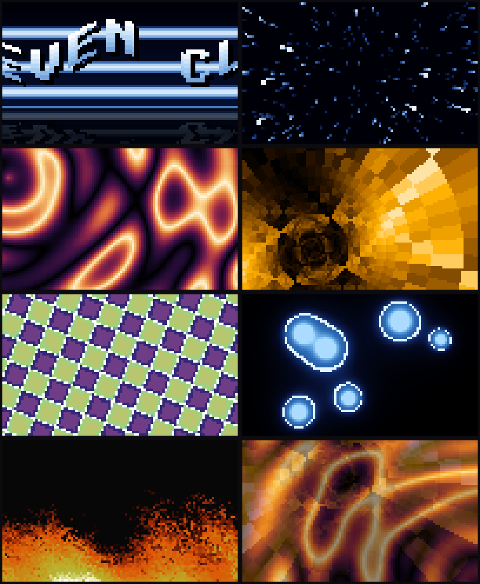

# termplasma

[](https://github.com/TheWingTheWong/termplasma/actions/workflows/ci.yml)

Seven classic demoscene effects, rendered live in a terminal: plasma, Doom fire,
a starfield, a texture-mapped tunnel, metaballs, a rotozoomer and a sine scroller.
It is written in Rust with one dependency (crossterm, for raw mode and input) and
targets 60 fps in a modern truecolor terminal.

Every character cell shows two pixels: the upper half block `▀` takes the top
pixel as its foreground color and the bottom pixel as its background. Only the cells
that changed since the last frame are re-sent, and each frame goes out in a single
write.



*Frames from `--headless --ppm`, the same pixels the terminal shows, enlarged 4x.
Left to right, top to bottom: scroller, starfield, plasma, tunnel, rotozoomer,
metaballs, fire, and a crossfade from plasma to tunnel.*

No recording tools are needed for a preview. This is the output of
`termplasma --headless --effect metaballs --frames 150 --size 76x18 --ascii`:

```text

                                                .,:*:,.
                                               .+-###-+.
                                               .+-*#*-+.
                                                .=:+:=.
                                                             .=,,,=.
                                                           .=;-+++-+=
        =,::=.                     .===.                   .;-#####-;.
      .+;+**-;=.                 .+;=+-;+,.                .+;*###*-+.
     .@;=###*-;@.                @;*###*+-;=.               .,+;-;+,.
     .@;-=**=-;;=.               .+-+*####=;.                  ..
    .=;;=*###*=;;=.               .=+;-++=;=.
    .@;-*######-;@.                  .==,=.
    .=;-*######-;@.
     .=;-+***+-;+.
      .=:++;++:=.
          ...
```

## Quickstart

From a checkout of this repository:

```sh
cargo run --release
cargo install --path .     # or install it as `termplasma`
```

`q`, `Esc` or `Ctrl-C` quits and restores the terminal. Use a release build; a
debug build runs too, but the effects are written for an optimiser.

```sh
cargo run --release -- --effect fire           # one effect, autoplay off
cargo run --release -- --palette c64           # force a palette everywhere
cargo run --release -- --bench                 # time every effect, no terminal needed
cargo run --release -- --list                  # effects and palettes
cargo run --release -- --help
```

## Controls

| Key | Action |
| --- | --- |
| `n`, `→` | next effect |
| `b`, `←` | previous effect |
| `1`-`7` | jump to an effect |
| `p` / `P` | next / previous palette |
| `0` | back to each effect's own palette |
| `space` | pause (the clock stops and the picture holds, so almost nothing is re-sent) |
| `a` | autoplay on or off |
| `[` / `]` | slower / faster (0.25x to 3x) |
| `f` | status line on or off |
| `h`, `?` | help panel |
| `q`, `Esc`, `Ctrl-C` | quit |

The status line on the bottom row shows the effect, the palette (a `*` marks a
manual override), the measured frame rate and the bytes sent per frame.

## The demo

Started without `--effect`, termplasma plays like an intro: each effect holds the
screen for 12 seconds (`--scene` changes that), then crossfades into the next over
1.6 seconds with a smoothstep ease. Manual switching uses a 0.45 second fade. Each
effect's clock starts at zero when it comes on screen, so the scroller always opens
on its first word.

```text
0:00.0  scroller    copper bars; "TERMPLASMA ..." enters from the right edge
0:12.0  fade        -> starfield, the field rolling slowly as it accelerates
0:25.6  fade        -> plasma, velvet palette cycling
0:39.2  fade        -> tunnel, amber phosphor
0:52.8  fade        -> rotozoomer on C64 colors
1:06.4  fade        -> metaballs, mercury palette
1:20.0  fade        -> fire, the PlayStation Doom ramp
1:33.6  fade        -> scroller, and around again
```

## The effects

All effects draw into a plain RGB frame buffer through 256-entry palettes. They
compute an 8-bit index and look the color up, which is what makes palette cycling
and live palette switching free. Effects size themselves from the buffer they are
handed and rebuild their tables when it changes, so any terminal size works,
including 1x1.

**Plasma.** A sum of four sine terms mapped through a cycling palette. Two of the
terms, a radial wave and a warped interference pattern, are precomputed once per
resize into tables twice the screen size. Each frame reads a screen-sized window
from each table at an offset that drifts on a Lissajous path, so the two layers
slide over each other and the pattern morphs without a single `sin` per pixel. A
per-column and a per-row term (lookups in a compile-time sine table) add travelling
bands. The sum is offset by time before the palette lookup: that is palette cycling.
The lookup is mirrored (up the palette, then back down), so a dark-to-bright ramp
cycles without a seam where 255 wraps to 0.

**Fire.** The cellular automaton from the PlayStation and N64 ports of Doom. The
bottom row is the heat source. Each step, every cell copies the heat of the cell
below it, shifted -2 to +1 columns at random (the bias makes the flames lean), minus
0 or 1, with both choices taken from one random number exactly as Doom's
`spreadFire` did. Heat has Doom's 37 levels, which is what gives coherent tongues
instead of noise. Because a 0-or-1 decay fixes how far a flame climbs (about 72
rows), the automaton runs on a 116-row grid at the screen's aspect ratio and is
resampled, so the fire looks the same in a 20-row terminal and a 120-row one. The
source row is modulated by two slow travelling sine waves to carve large tongues.
The simulation steps at a fixed 60 Hz regardless of the render rate.

**Starfield.** Stars live in a unit cube in front of the camera. Each frame their
depth shrinks and they are projected with a perspective divide,
`screen = center + xy / z * focal`. Stars that pass the near plane or leave the
screen respawn at the far plane. Each star is drawn as a line from last frame's
projected position to this one, so close, fast stars become streaks. The whole
field rolls around the view axis and the speed swells and eases.

**Tunnel.** For every pixel, the angle around the tunnel axis (`atan2`, texture u)
and the depth (`k / radius`, texture v) are computed once per resize, along with a
depth fog. A frame is then two table reads, two adds for motion (scrolling v moves
forward, scrolling u rotates) and one texel fetch per pixel. The tables are twice
the screen size and sampled through a moving window, which moves the vanishing
point around. The texture is the XOR pattern `u ^ v` with its three lowest bits
dropped, because they only add texel-sized grain that aliases at terminal
resolution.

**Metaballs.** Each ball contributes `r² / d²` at every pixel, and the surface is
where the sum crosses 1.0. Because fields add, nearby balls bulge toward each other
and merge. The squared distance splits into `dx² + dy²`, so each frame every ball
gets one table of `dx²` per column and one of `dy²` per row, and the per-pixel cost
is an add and a division per ball. Shading has three bands: a quadratic glow
outside, a bright rim at the threshold, and a body that brightens toward each core.

**Rotozoomer.** Rotation plus zoom is an affine map, so one step right on screen
always moves the texture coordinate by the same vector `(du, dv)` and one step
down moves it by `(-dv, du)`. Both come from the integer sine table in 16.16 fixed
point once per frame. The inner loop is two wrapping adds and a masked texture read.
Overflow is harmless by design: only bits 16 to 23 are ever used. The 256x256
texture is a procedural checkerboard of bevelled tiles with bright grout lines and
a faint diagonal sheen. On the banded C64 palette the bevels quantize into hard
color steps, as they would have on the real machine.

**Sine scroller.** Each screen column maps to one column of one glyph of the
message, displaced vertically by a sine of its x position and time, so the wave
holds still while the letters travel through it. Glyphs come from an 8x8 font
authored for this project as ASCII art in `src/font.rs` and packed into bytes by a
`const fn` at compile time; a malformed glyph fails the build. Behind the text,
copper bars imitate the Amiga copper coprocessor, which changed the background
color on chosen scanlines. Below the horizon each row copies a mirrored row from
above with a sinusoidal sideways ripple and increasing darkness.

### Palettes

| Name | Source | Default for |
| --- | --- | --- |
| `velvet` | aubergine through oxblood to cream | plasma |
| `doom` | the 37-entry PlayStation Doom fire ramp | fire |
| `copper` | Amiga copper bars: navy, steel blue, white core | scroller, starfield |
| `amber` | P3 amber phosphor | tunnel |
| `mercury` | indigo to a hard white highlight | metaballs |
| `c64` | eight Commodore 64 VIC-II colors as hard bands | rotozoomer |
| `phosphor` | P1 green phosphor | |

Every palette starts at or near black at index 0, so effects that treat the index
as intensity work with all of them.

## How the renderer works

`src/render.rs` turns a frame buffer into terminal output in three steps.

1. **Compose.** Pixel rows `2r` and `2r + 1` become cell row `r`. A cell whose two
   pixels match is stored as a space with only a background color. Text overlays
   (the status line, the help panel) are stamped on top; without a solid
   background they darken the pixels underneath for contrast.
2. **Diff.** The renderer keeps a copy of what the terminal currently shows. A cell
   is encoded only if it differs from that copy. With `--tolerance N`, a cell whose
   channels all moved by at most N is skipped. The comparison is against the
   screen, not the previous frame, so the error cannot accumulate.
3. **Encode.** Changed cells are written in row order. A contiguous run needs no
   cursor movement; a gap on the same row uses a short cursor-forward (`CSI n C`);
   anything else uses an absolute move. Colors already selected are not re-sent,
   and when both change they share one SGR sequence. A two-color cell can be drawn
   as `▀` or as `▄` with the colors swapped, and a flat cell as a space or a full
   block `█`; the encoder picks whichever reuses the colors the terminal already
   has. Numbers are formatted by hand into one reused buffer, and the frame is
   wrapped in DEC mode 2026 synchronized-update markers so supporting terminals
   never show a half-drawn frame (others ignore them).

The terminal is put into raw mode, the alternate screen and a hidden cursor by a
guard object whose `Drop` restores everything, so a normal exit, an error and a
panic all leave the shell as it was. A panic hook restores the terminal before the
panic message prints. In raw mode `Ctrl-C` arrives as a key press and is handled
like `q`. Resizes reallocate the buffers and force a full redraw.

Truecolor is used unless the terminal is known to lack it (Apple Terminal, the
Linux console), in which case colors are mapped to the xterm 256-color cube and
gray ramp. `--colors truecolor|256` overrides the detection.

## Performance

`--bench` runs every effect through the full pipeline (effect, crossfade logic,
compose, diff, encode) into memory and reports the cost per frame. On an Apple M2,
600 frames per effect at 120x40 cells (120x80 pixels):

```text
effect      effect ms  encode ms       fps bytes/frame   re-sent
scroller        0.013      0.058     14000     15.0 KB     53.9%
starfield       0.010      0.052     16041     16.0 KB     19.6%
plasma          0.013      0.222      4251    133.6 KB     90.3%
tunnel          0.013      0.103      8679     41.4 KB     43.9%
rotozoom        0.008      0.060     14767     17.6 KB     23.9%
metaballs       0.037      0.127      6081     62.7 KB     48.4%
fire            0.066      0.102      5953     38.9 KB     34.9%
```

The CPU side is a fraction of a millisecond, so the real limit is how fast the
terminal can parse escape sequences. Plasma is the worst case: almost every cell
changes every frame, and a truecolor cell with two new colors costs about 30
bytes, so 60 fps at this size is roughly 8 MB/s of output. Terminals with GPU
renderers (kitty, WezTerm, Alacritty, Ghostty) are built for that kind of
throughput; slower ones show it in the fps readout. If yours struggles:

- `--tolerance 4` skips cells that changed imperceptibly. On plasma at 120x40 it
  cuts output from 134 KB to 96 KB per frame; `--tolerance 8` to 69 KB.
- `--colors 256` makes every color code shorter, and because nearby colors
  collapse onto the same cube entry, far fewer cells change: plasma drops to
  26 KB per frame.
- `--fps 30` halves the bandwidth.
- A smaller terminal window scales the cost with the cell count.

Where it matters, the effects avoid floating point in the inner loops: sine tables
(Q16.16 and 8-bit) are generated at compile time by a `const fn` Taylor series,
the rotozoomer is pure 16.16 fixed point, plasma and tunnel do table lookups only,
and fire is integer arithmetic on bytes.

## Headless mode and tests

`--headless` drives the same demo, renderer and encoder without a terminal, with a
fixed time step so runs are reproducible:

```sh
termplasma --headless --frames 600 --size 120x40       # timing and bandwidth report
termplasma --headless --effect plasma --ascii          # print the last frame
termplasma --headless --effect fire --ppm fire.ppm     # save it as an image
```

`cargo test` runs 85 tests, including:

- **Encoder replay.** Random frame sequences with overlays, at several sizes, in
  both color modes and across a resize, are rendered and the byte stream is fed to
  a small terminal emulator in `tests/replay.rs`. Every cell on the emulated
  screen must match the intended frame. This catches skipped cells, stale colors
  carried across cursor jumps and off-by-one cursor moves that byte-exact unit
  tests miss.
- **Renderer unit tests.** Exact output for single-cell changes, run and gap
  handling, SGR reuse, glyph flipping, tolerance without drift, resize and
  invalidation, overlays, the 256-color path.
- **Palette and color math.** Gradient stops reproduced exactly, monotonic
  fixed-point mixing, seamless mirrored cycling, banded palettes, 256-color
  round trips.
- **Every effect at every size.** Thirteen sizes from 0x0 to 400x20, paused, huge
  and tiny time steps, one instance resized through all of them, and clock values
  in the millions of seconds. Each effect must also animate, overwrite every pixel and follow the
  palette.
- **Demo engine.** Autoplay timing, crossfade blending, selection mid-fade,
  per-effect clocks, pause, speed clamping, palette overrides.

## Project layout

```text
src/
  main.rs         argument handling, headless report, --bench, --list
  app.rs          terminal session: raw mode guard, input, frame pacing, resize
  demo.rs         effect sequencing, crossfades, playback state
  render.rs       half-block composition, diffing, ANSI encoding
  framebuffer.rs  the RGB pixel canvas
  palette.rs      256-entry palettes and the built-in set
  color.rs        RGB math, xterm-256 mapping
  lut.rs          compile-time sine tables
  font.rs         the 8x8 font
  hud.rs          status line, help panel, fps meter
  preview.rs      ASCII and PPM frame export
  cli.rs          argument parser
  rng.rs          xorshift32
  effects/        one module per effect behind the Effect trait
tests/
  replay.rs       encoder replay through a minimal terminal emulator
  effects.rs      effect robustness across sizes and timings
```

Adding an effect means implementing three methods (`name`, `palette`, `render`) and
adding it to `effects::all()`; the effect tests pick it up automatically.

## Roadmap

- Sixel and kitty graphics output as an alternative to half-blocks, for full
  resolution where the terminal supports it.
- Quarter-block and braille modes (2x2 and 2x4 pixels per cell) for the
  monochrome effects.
- Bump-mapped and environment-mapped variants of the tunnel and rotozoomer.
- Vector balls and a shaded 3D object, the other half of the classic intro.
- A frame-time budget that lowers resolution automatically when the terminal falls
  behind.
- A small timeline format to script custom demo sequences with music sync points.

## License

MIT. See [LICENSE](LICENSE).
